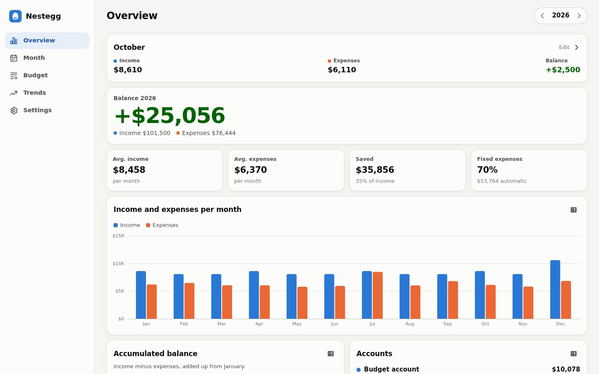

# Nestegg

A self-hosted family budget for phones and computers. Plan each person's
income and expenses month by month, keep every year in one place, and see where
the money goes.

Made for households that have outgrown a budget spreadsheet: no cells and no
formulas. Just say what comes in and goes out, and how often, and Nestegg does
the sums and the charts.

<p>
  
  
  
  
</p>


## What it does

- **Everyone in the household gets their own budget**, kids too, plus a
  shared one for rent, groceries, the car and so on.
- **One app for all years.** Items carry over from year to year with their
  history, and a new year starts as a copy of the last one with one tap.
- **Budget items in plain words.** "2,500 every month", "1,551 every quarter
  from January", "3,248 in February". Tap a single month to change just that one
  when it differs.
- **Made for the phone.** The Month view lists this month's amounts with a
  number keypad, Enter jumps to the next amount, and you can type `120+45` to
  add up receipts. On a computer the same app simply gets more room.
- **Account balances.** Follows the budget account and savings month by month.
  Type the real balance from the bank when it differs, and the following months
  continue from there.
- **Statistics:** balance, average monthly income and expenses, how much was
  saved and the savings rate, fixed versus variable expenses, per person, per
  category, the largest expenses, and trends and comparisons across years.
  Every chart can be shown as a table.
- **Import** from Excel/CSV/Google Sheets, export a year to CSV, and back up or
  restore everything as one JSON file.
- Installs as an app on the phone's home screen. Light and dark mode. English
  and Danish, any currency and number format.
- Your data stays on your server: one SQLite file, no accounts, no tracking,
  no external services.

## Run it

With Docker Compose (see [`docker-compose.yml`](docker-compose.yml)):

```yaml
services:
  nestegg:
    image: ghcr.io/kasperskytte/nestegg:latest
    restart: unless-stopped
    ports:
      - "8000:8000"
    volumes:
      - ./data:/data
    environment:
      NESTEGG_PASSWORD: ""   # optional, see below
```

```bash
docker compose up -d
```

Open `http://<server>:8000` and set up the household. To build the image
yourself instead, run `docker build -t nestegg .` in this folder.

### Settings

| Variable | Default | |
|---|---|---|
| `NESTEGG_PASSWORD` | *(empty)* | Require this password to log in. Empty means anyone who can reach the app can use it, which is fine on a home network you trust. |
| `NESTEGG_SECRET` | *(generated)* | Key that signs login cookies. Generated into the data folder if not set. |
| `NESTEGG_DATA_DIR` | `/data` | Where the database lives. |

### On the phone

Open the address in the phone's browser and choose **Add to Home Screen**
(Safari's share menu on iPhone, the ⋮ menu in Chrome on Android). Nestegg then
opens full screen like any other app.

Android only installs a real app (rather than a bookmark) when the site is
served over **HTTPS**. Put Nestegg behind the reverse proxy you already use
(Caddy, Traefik, Nginx Proxy Manager, SWAG…), for example
`https://budget.example.home`. It works over plain HTTP too, just without the
offline start-up.

### Backups

Everything is in `data/nestegg.db`. Copy that file (preferably while the
container is stopped), or use **Settings → Download a backup** for a JSON file
that **Restore a backup** reads back in.

## Bringing in an old spreadsheet

If your budget lives in Excel or Google Sheets today, **Settings → Import from a
spreadsheet** brings it in once, so you can leave the spreadsheet behind. It
reads `.xlsx` and `.csv` files with one row per item and one column per month:

```
          Jan    Feb    Mar  …
Salary    31250  34600  31250
Rent      12450  12900  12300
```

Every tab becomes a list you assign to a person, as income or expenses. Tabs
that are mostly formulas (summaries) are left out, minus signs are handled, and
numbers like `1.234,50` and `1,234.50` both work. From Google Sheets, use
*File → Download → Microsoft Excel*. Import one file per year: items with the
same name are joined, so their history follows them across years.

## How the numbers work

- **Items** are an income or an expense belonging to a person or to the shared
  budget, with an amount for each month. Amounts are always positive; whether
  money comes in or goes out depends on the item.
- **Balance** is income minus expenses.
- An expense that **moves money to a savings account** (pick the account on the
  item) still counts as an expense in the budget, but adds to that account's
  balance and counts as **saved**. The savings rate is what was saved plus
  what was left over, as a share of income.
- The **budget account** changes each month by income minus expenses. Account
  balances need one real balance to start from, typed in the Month view.
- **Fixed** marks items paid by automatic transfer or direct debit, so you can
  see how much of the budget is locked in.

## Bank connections

Not built in (yet). Banks in the EU and UK must offer read access to accounts
under PSD2, but only to licensed providers, so a self-hosted app needs an
intermediary. The free option for individuals was GoCardless Bank Account Data
(formerly Nordigen), which no longer accepts new sign-ups. **Enable Banking**
offers a free "restricted" production mode limited to accounts you link
yourself, which is what other self-hosted apps such as Firefly III use. That
would be the way to add it. Until then, most net banks can export transactions
as CSV.

## Development

```bash
python -m venv .venv
.venv/bin/pip install -r requirements-dev.txt
NESTEGG_DATA_DIR=./data .venv/bin/uvicorn app.main:app --reload
.venv/bin/pytest
```

To try it with made-up data: start it with an empty data folder and run
`python scripts/seed_demo.py http://localhost:8000`.

- `app/`: FastAPI backend. `calc.py` has all the totals and balances, `importer.py`
  reads spreadsheets, and the schema and migrations are in `db.py`. Money is
  stored as whole cents.
- `static/`: the web app, with no build step: [Preact](https://preactjs.com) and
  [htm](https://github.com/developit/htm) are vendored in `static/vendor`, and
  the charts are plain SVG.
- Translations are in `static/js/i18n.js`. To add a language, copy the `en`
  block and translate it.
- The API is documented at `/api/docs` on a running instance.

## License

MIT
