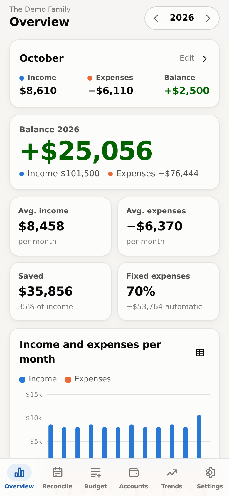
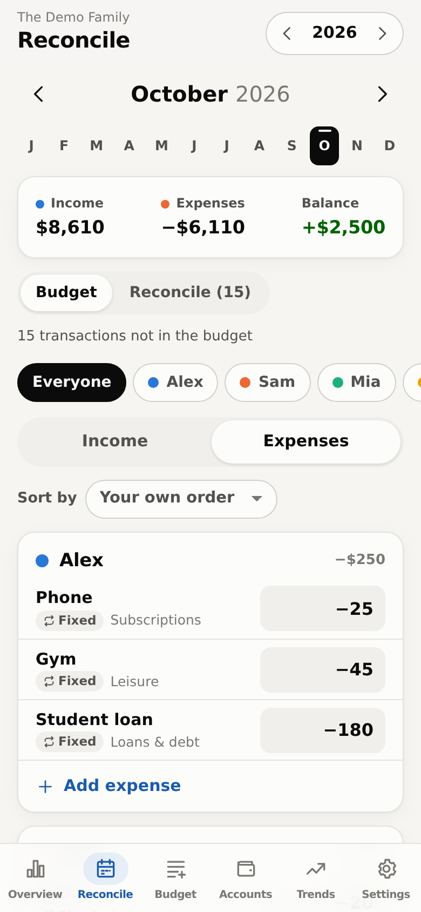
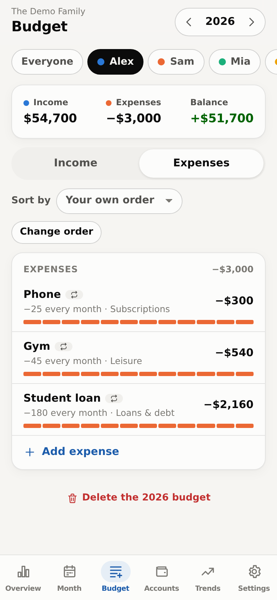
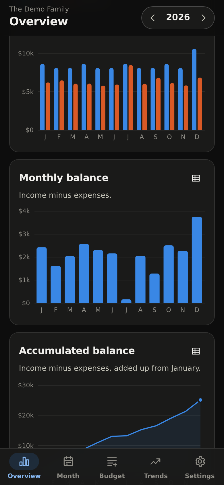
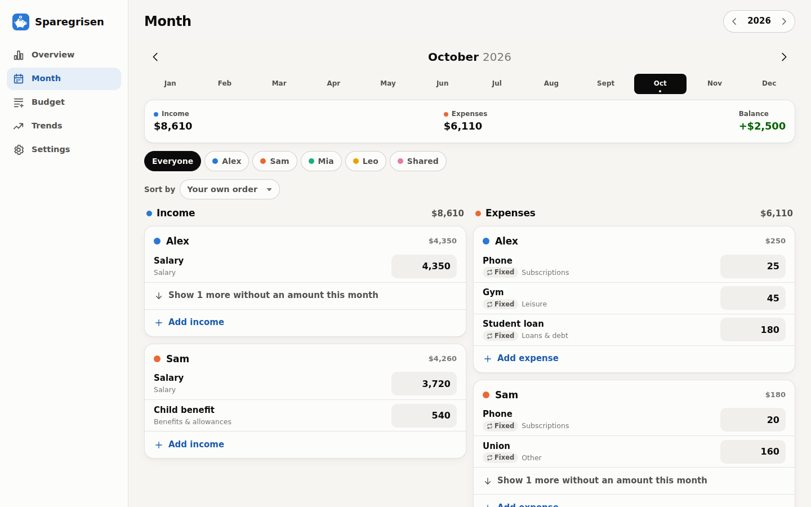

# Sparegrisen

*Danish for “the piggy bank”.* A family budget you run yourself. Write down what comes in and what goes out,
for each person in the household, and Sparegrisen keeps track of it month by month
and year by year, with the sums and charts done for you.

It's made for the phone first, works just as well on a computer, and your data
stays on your own server.

<p>
  
  
  
  
</p>


## Features

- **A budget for each person**, kids included, plus a shared one for rent,
  groceries and the like.
- **Simple items.** "2,500 every month" or "880 every quarter". When one month
  is different, tap it and change just that month.
- **Every year in one place.** Start next year from this year with one tap.
- **An overview** of income, expenses, the monthly balance, savings and where
  the money goes, per person and per category, and how it changes over the years.
- **Bank sync (optional).** Your bank accounts and their real balances show up
  by themselves, and you see what was actually paid next to what you planned.
- **Reconcile each month.** See the bank's transactions that aren't in the
  budget yet, by account and payment type (card, Betalingsservice…), and the
  items where the bank paid more or less than planned. Tell it to sort a
  payment by itself from then on, and only what changed is left to look at.
- **Accounts as they are used:** one budget account everything flows through,
  savings, and expense accounts (money moved there is spent from there). Read
  month-end balances on the last day, or the day before payday so the salary
  doesn't make every account look full.
- **Checks the numbers.** Amounts that look 10, 100 or 1000 times off, the
  usual result of a comma read as a dot, are flagged with a one-tap fix, and
  the overview tells you when the totals can't be trusted yet.
- **Export to Excel**, and import your old budget spreadsheet.
- One login per household. Several households can share a server.
- Sort items by amount, name or category.
- Expenses are shown as negative numbers everywhere, in charts and the Excel
  export too. Type them without the minus; a plus on an expense is money back.
- English and Danish, any currency, comma or dot decimals (or whole numbers
  only), light and dark mode.

## Getting started

You need a computer that's always on, like a home server or a Raspberry Pi, with
[Docker](https://docs.docker.com/get-docker/). Save this as `docker-compose.yml`:

```yaml
services:
  sparegrisen:
    image: ghcr.io/kasperskytte/sparegrisen:latest
    restart: unless-stopped
    ports:
      - "8000:8000"
    volumes:
      - ./data:/data
```

Then run `docker compose up -d`, open `http://<your-server>:8000`, and create
your budget. You pick a budget name and a password that the whole household
shares.

**On your phone**, open the same address and add it to your home screen: the
app shows you how under **Settings → Install as app**. Sparegrisen then opens like
a normal app. On Android this works best over https, so if you have a reverse
proxy (Caddy, Traefik, Nginx Proxy Manager…), put Sparegrisen behind it.

## Connecting your bank

Sparegrisen can read balances and transactions from your bank through
[Enable Banking](https://enablebanking.com), which works with most banks in
Europe and is free when you only connect your own accounts. Sparegrisen can only
read; it can never move money.

Setting it up takes about ten minutes, and the app walks you through every step
under **Settings → Bank**. After that, Sparegrisen syncs by itself a few times a
day. Every few months your bank asks you to log in again, and Sparegrisen tells you
when.

Your bank accounts then appear under **Settings → Accounts**, where you can give
them your own names. Which accounts Sparegrisen sees is decided at the bank: leave
an account out there (or unlink it in Enable Banking) and it disappears from
Sparegrisen with all its data.

Each month, the **Reconcile (Afstemning)** page shows the transactions that
aren't on the budget yet and the items where the bank and the budget differ.
Put a transaction on an item, and turn on "Do it automatically from now on"
(choose "Vælg post…") when the same payment, with the same amount, should be
sorted by itself next time. When a
transaction has exactly an item's amount, it is also offered right at the item.

## Moving from a spreadsheet

If your budget is in Excel or Google Sheets with one row per item and one column
per month, **Settings → Import** brings it in. Import one file per year and the
items are joined up across years. From Google Sheets, use *File → Download →
Microsoft Excel* first.

## Backups

Everything lives in the `data` folder, so back that up. You can also download a
backup of your budget from **Settings → Data**.

## Settings

Most people won't need these. Set them under `environment:` in
`docker-compose.yml`.

| Setting | What it does |
|---|---|
| `SPAREGRISEN_ALLOW_NEW_BUDGETS=false` | Stops others from creating new budgets on the login page. Use it if your server can be reached from the internet. |
| `SPAREGRISEN_BANK_SYNC_HOURS=6` | How often to sync with the bank. `0` turns automatic syncing off. |
| `SPAREGRISEN_PUBLIC_URL` | The address of your Sparegrisen, e.g. `https://budget.example.com`, if the bank sends you back to the wrong address. |

## Development

```bash
python -m venv .venv
.venv/bin/pip install -r requirements-dev.txt
SPAREGRISEN_DATA_DIR=./data .venv/bin/uvicorn app.main:app --reload
.venv/bin/pytest
```

Run `python scripts/seed_demo.py http://localhost:8000` to add a made-up family
to play with (log in as `demo` / `demo-demo`). The backend is FastAPI with SQLite in
`app/`, and the frontend in `static/` has no build step (Preact and htm are
included). Translations live in `static/js/i18n.js`. To add a language, copy
the English block.

## License

MIT
