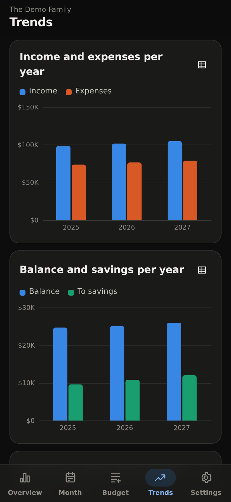

# Jetbuddy

A family budget you run yourself. Write down what comes in and what goes out,
for each person in the household, and Jetbuddy keeps track of it month by month
and year by year, with the sums and charts done for you.

It's made for the phone first, works just as well on a computer, and your data
stays on your own server.

<p>
  
  
  
  
</p>

## Features

- **A budget for each person**, kids included, plus a shared one for rent,
  groceries and the like.
- **Simple items.** "2,500 every month" or "880 every quarter". When one month
  is different, tap it and change just that month.
- **Every year in one place.** Start next year from this year with one tap.
- **An overview** of income, expenses, savings and where the money goes, per
  month, per person and per category, and how it changes over the years.
- **Bank sync (optional).** See your real account balances, and what was
  actually paid next to what you planned.
- **Export to Excel**, and import your old budget spreadsheet.
- One login per household. Several households can share a server.
- English and Danish, any currency, light and dark mode.

## Getting started

You need a computer that's always on, like a home server or a Raspberry Pi, with
[Docker](https://docs.docker.com/get-docker/). Save this as `docker-compose.yml`:

```yaml
services:
  jetbuddy:
    image: ghcr.io/kasperskytte/jetbuddy:latest
    restart: unless-stopped
    ports:
      - "8000:8000"
    volumes:
      - ./data:/data
```

Then run `docker compose up -d`, open `http://<your-server>:8000`, and create
your budget. You pick a username and password that the whole household shares.

**On your phone**, open the same address and choose *Add to Home Screen*.
Jetbuddy then opens like a normal app. On Android this works best over https,
so if you have a reverse proxy (Caddy, Traefik, Nginx Proxy Manager…), put
Jetbuddy behind it.

## Connecting your bank

Jetbuddy can read balances and transactions from your bank through
[Enable Banking](https://enablebanking.com), which works with most banks in
Europe and is free when you only connect your own accounts. Jetbuddy can only
read; it can never move money.

Setting it up takes about ten minutes, and the app walks you through every step
under **Settings → Bank**. After that, Jetbuddy syncs by itself a few times a
day. Every few months your bank asks you to log in again, and Jetbuddy tells you
when.

Transactions show up in the month view, where you put each one on a budget item.
Tick "do the same next time" and future ones sort themselves.

## Moving from a spreadsheet

If your budget is in Excel or Google Sheets with one row per item and one column
per month, **Settings → Import** brings it in. Import one file per year and the
items are joined up across years. From Google Sheets, use *File → Download →
Microsoft Excel* first.

## Backups

Everything lives in the `data` folder, so back that up. You can also download a
backup of your budget from **Settings → Data**.

## Settings

Most people won't need these. Set them under `environment:` in
`docker-compose.yml`.

| Setting | What it does |
|---|---|
| `JETBUDDY_ALLOW_NEW_BUDGETS=false` | Stops others from creating new budgets on the login page. Use it if your server can be reached from the internet. |
| `JETBUDDY_BANK_SYNC_HOURS=6` | How often to sync with the bank. `0` turns automatic syncing off. |
| `JETBUDDY_PUBLIC_URL` | Your Jetbuddy address, e.g. `https://budget.example.com`, if the bank sends you back to the wrong address. |

## Development

```bash
python -m venv .venv
.venv/bin/pip install -r requirements-dev.txt
JETBUDDY_DATA_DIR=./data .venv/bin/uvicorn app.main:app --reload
.venv/bin/pytest
```

Run `python scripts/seed_demo.py http://localhost:8000` against an empty instance
to get a made-up family to play with. The backend is FastAPI with SQLite in
`app/`, and the frontend in `static/` has no build step (Preact and htm are
included). Translations live in `static/js/i18n.js`. To add a language, copy
the English block.

## License

MIT
